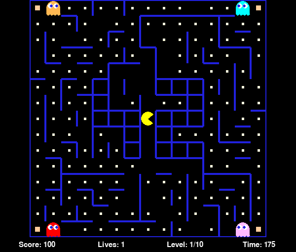
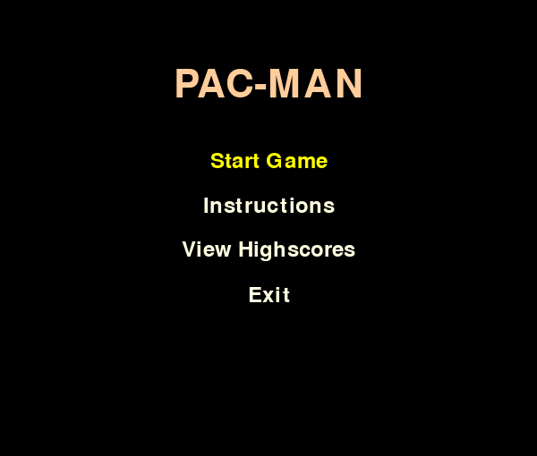
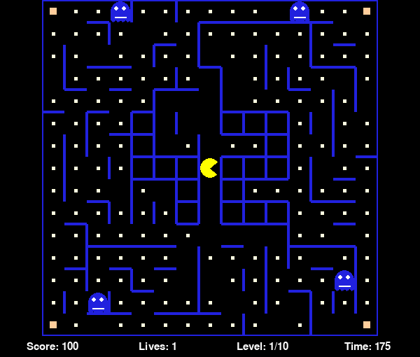
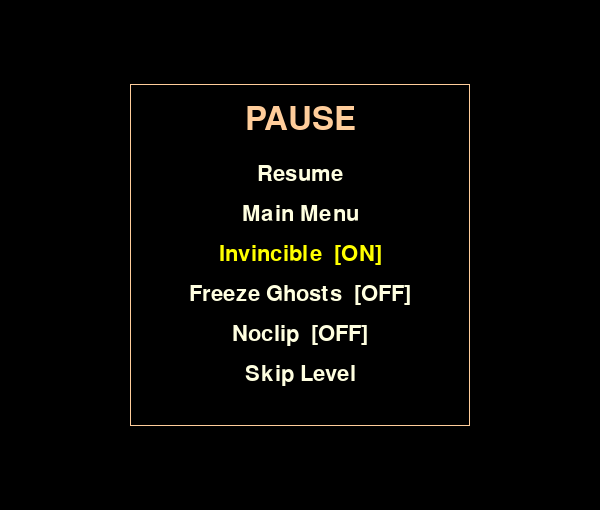
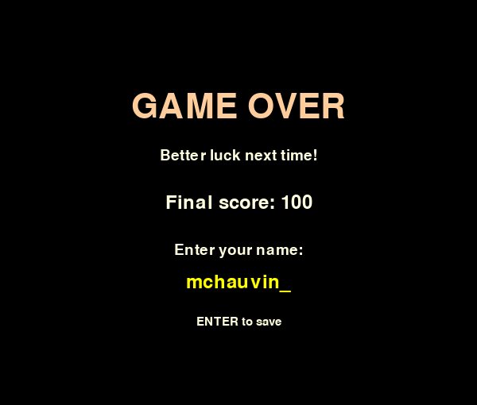
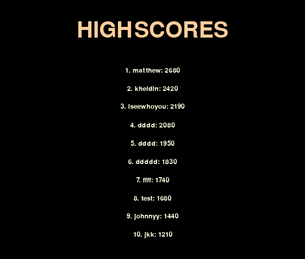
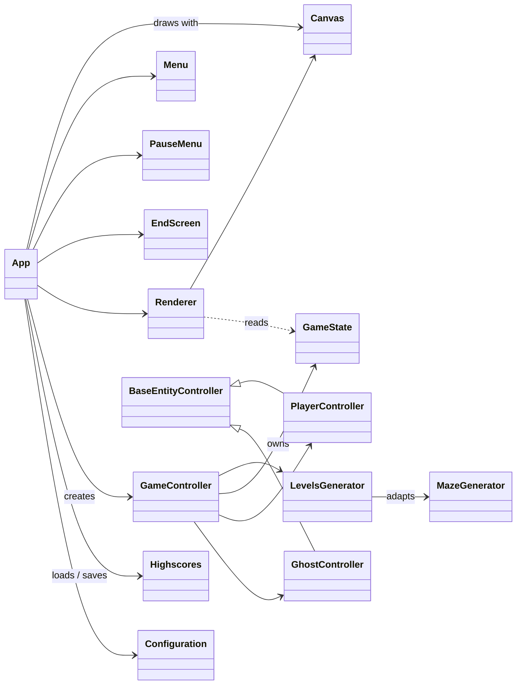
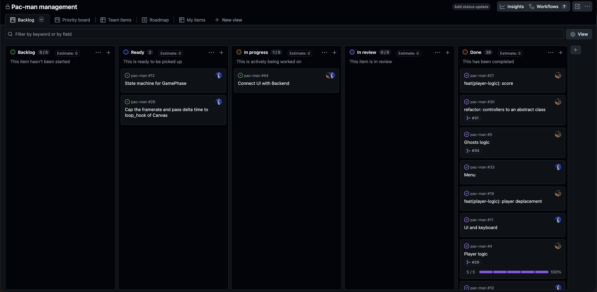

*This project has been created as part of the 42 curriculum by equentin, mchauvin.*

# Pac-man

## Description
The goal is to create a complete and playable Pac-Man game in Python, using
object-oriented programming, a simple graphical library, and a modular, reusable architecture.

<p align="center">
  
</p>

Pac-Man moves through a procedurally generated maze, eats every pacgum to clear the level and avoids the four ghosts chasing him. Eating a super-pacgum in a corner turns the ghosts blue for a few seconds, and Pac-Man can eat them.

**Features**
- 10 levels: the first one uses a fixed seed, the others are random mazes.
- 4 ghosts that chase the player with a BFS pathfinding, run away when scared and go back to their corner when eaten.
- Score, lives, level and remaining time shown in a HUD.
- Main menu, instructions, top 10 highscores, pause menu, game over and victory screens.
- A JSON configuration file with `#` comments, and safe defaults for every value.
- A cheat mode in the pause menu, to help peer review.
- A packaged build published on itch.io for Linux, Windows and macOS.

<table>
  <tr>
    <td align="center"><br><sub>Main menu</sub></td>
    <td align="center"><br><sub>Super-pacgum: scared ghosts</sub></td>
    <td align="center"><br><sub>Pause menu and cheats</sub></td>
  </tr>
</table>

## Instructions

### Requirements
- Python 3.13 or later
- [uv](https://docs.astral.sh/uv/) to install the dependencies (`pygame`, `pydantic`, and the assigned `mazegenerator` package, shipped as a wheel at the root of the repository)

### Install and run

```bash
make install            # uv sync: creates .venv and installs the dependencies
make run                # python3 pac-man.py src/config.json
```

You can also launch the game by hand with any configuration file:

```bash
uv run python3 pac-man.py path/to/config.json
```

The program takes **exactly one argument**: a `.json` configuration file. Any error (missing file, wrong extension, invalid content) prints a clear message instead of a Python traceback.

### Other Makefile rules

| Rule | Description |
| :--- | :--- |
| `make debug` | Runs the game with Python's debugger (`pdb`). |
| `make lint` | Runs `flake8` and `mypy` with the flags required by the subject. |
| `make lint-strict` | Same as `lint`, with `mypy --strict`. |
| `make package` | Builds a standalone executable with PyInstaller (`pac-man.spec`) into `dist/pac-man/`, with `config.json` and `HOW_TO_PLAY.txt` next to it. |
| `make clean` | Removes `__pycache__`, `.mypy_cache`, `build/` and `dist/`. |

### Controls

| Key | Action |
| :--- | :--- |
| Arrow keys / WASD / ZQSD | Move Pac-Man, navigate the menus |
| `Enter` | Confirm a menu option, save your name |
| `Escape` | Pause / resume the game, go back from a sub-menu |
| `Space` | Go to the next level once a level is completed |
| `Backspace` | Erase a letter when typing your name |

### Cheat mode

Press `Escape` during a game to open the pause menu. The cheats stay active between levels.

| Cheat | Effect |
| :--- | :--- |
| **Invincible** | Ghosts can no longer kill Pac-Man. |
| **Freeze Ghosts** | Ghosts stop moving. |
| **Noclip** | Pac-Man walks through walls (but stays inside the maze). |
| **Skip Level** | Immediately wins the current level. |

### Packaged build (itch.io)

The game is published on itch.io as a free, unlisted build. The [`release.yml`](./.github/workflows/release.yml) GitHub Actions workflow, started by hand from the *Actions* tab, builds the game with PyInstaller on Linux, Windows and macOS, then uploads each build to its itch.io channel with `butler`.

In the packaged build, the game reads `config.json` and writes `highscores.json` next to the executable. Controls and options are also explained in [`HOW_TO_PLAY.txt`](./packaging/HOW_TO_PLAY.txt).

## Configuration

**Comment Support**: You can annotate your configuration file using `#` at the beginning of any line to add notes or temporarily disable lines.  
**Automatic Recovery**: If a key is missing, misspelled, or set to an invalid value (e.g., negative lives or an extreme speed), the game will not crash. Instead, it logs a warning: an out-of-range value is clamped to its minimum or maximum, any other invalid value falls back to its default. Unknown keys are ignored.  
**Levels**: A game always has 10 levels, all using the `width` and `height` of the configuration file.  

### Global Settings

| Setting | Type | Default | Allowed Range | Description |
| :--- | :---: | :---: | :---: | :--- |
| `highscore_filename` | Text | `"highscores.json"` | Valid filename | Name of the file where the top 10 scores are saved. |
| `lives` | Whole number | `3` | At least `1` | Number of lives the player starts with. |
| `level_max_time` | Whole number | `300` | At least `1` | Time limit to finish each level (in seconds). |
| `seed` | Whole number | `42` | Greater than `0` | Starting seed for procedural maze generation (Level 1). |

---

### Scoring Rules

| Setting | Type | Default | Allowed Range | Description |
| :--- | :---: | :---: | :---: | :--- |
| `points_per_pacgum` | Whole number | `10` | 0 or more | Points awarded when eating a standard dot. |
| `points_per_super_pacgum` | Whole number | `50` | 0 or more | Points awarded when eating a large power pellet. |
| `points_per_ghost` | Whole number | `200` | 0 or more | Points awarded when eating a vulnerable (blue) ghost. |

---

### Speeds & Timers (Game Balance)

| Setting | Type | Default | Allowed Range | Description |
| :--- | :---: | :---: | :---: | :--- |
| `player_speed` | Decimal | `6.0` | `1.0` to `15.0` | Pac-Man's movement speed in tiles per second. |
| `ghost_speed` | Decimal | `5.0` | `1.0` to `15.0` | Base movement speed of ghosts in tiles per second. |
| `ghost_scared_timer` | Decimal | `10.0` | At least `3.0` | How long ghosts remain edible after a power pellet (seconds). |
| `ghost_respawn_timer` | Decimal | `10.0` | At least `3.0` | Delay before an eaten ghost returns to normal chasing (seconds). |
| `ghost_scared_multiplier` | Decimal | `0.75` | `0.0` to `2.0` | Speed ratio when ghosts are scared (`0.75` = 25% slower). |

---

### Level Customization
| Setting | Type | Default | Allowed Range | Description |
| :--- | :---: | :---: | :---: | :--- |
| `width` | Whole number | `10` | `5` to `80` | Maze width, in tiles. |
| `height` | Whole number | `10` | `5` to `48` | Maze height, in tiles. |

The maximum size makes sure the maze still fits in the window (1280×800) with tiles of at least 16 pixels.

> **Note**: For optimal gameplay and visual balance, odd numbers (e.g., 15, 19, 21) are recommended for both width and height.

---

### Example `config.json`

Here is a configuration file showing comments, custom scoring, and tailored levels:

```json
{
    # Save file for high scores
    "highscore_filename": "my_scores.json",

    # Gameplay settings
    "lives": 3,
    "level_max_time": 180,
    "seed": 42,

    # Speeds (in tiles per second)
    "player_speed": 6.5,
    "ghost_speed": 5.0,
    "ghost_scared_multiplier": 0.6,

    # Scoring
    "points_per_pacgum": 10,
    "points_per_super_pacgum": 50,
    "points_per_ghost": 200,

    # Level size
    "height": 21,
    "width": 21
}
```

## Highscore
The highscore system displays and keeps only the 10 higher scores. We implemented this way because it's not useful to keep lower scores as it takes space.

* **Storage**: Scores are saved in a JSON file (`highscore_filename` in the configuration, `highscores.json` by default). JSON is easy to read and edit by hand, and `pydantic` already gives us the validation.
* **Loading**: The file is loaded when the game starts. If it is missing, the list starts empty. Each entry is validated one by one, so a corrupted entry is dropped without losing the other scores, and an unreadable file only logs a warning.
* **Saving**: At the end of a game (win or lose), the player types a name: 3 to 10 characters, letters, digits and spaces only. The score is added, the list is sorted and cut to the best 10, then written to disk.
* **Display**: The top 10 is shown from *View Highscores* in the main menu.

```json
{
    "score": [
        { "username": "matthew", "score": 2680 },
        { "username": "kheldin", "score": 2420 }
    ]
}
```

<table>
  <tr>
    <td align="center"><br><sub>Name entry at the end of a game</sub></td>
    <td align="center"><br><sub>Top 10 in the main menu</sub></td>
  </tr>
</table>

## Maze Generation

In compliance with project specifications, mazes are generated using the mazegenerator package integrated **as-is without any internal modifications**. Our backend acts as an adapter layer through `LevelsGenerator` to convert the raw generated grid into a fully playable Pac-Man stage.

### Integration & Parameters

The generator is instantiated for each level with specific constraints tailored to Pac-Man gameplay:

```python
maze = MazeGenerator(
    size=(level.width, level.height),
    perfect=False,
    seed=config.seed if level_index == 0 else 0
)
```

* **Non-Perfect Mazes (`perfect=False`)**: Standard perfect mazes contain only a single path between any two points and numerous dead-ends, which would make escaping ghosts impossible.
* **Seed Management**:
  * **Level 1**: Generated using the fixed `seed` provided in `config.json`. This guarantees deterministic behavior and reproducible evaluation during defense.
  * **Subsequent Levels (2 to 10+)**: Generated with randomized seeds (`seed=0`), ensuring every subsequent level features a unique, procedurally generated layout.

### Grid Representation: Bitmask Walls

The assigned generator outputs the maze as a 2D integer array (`list[list[int]]`). Each tile stores its wall boundaries as a 4-bit bitmask:

| Bit | Value | Direction | Meaning |
| :---: | :---: | :---: | :--- |
| `0` | **1** | North (UP) | Wall blocks movement upwards |
| `1` | **2** | East (RIGHT) | Wall blocks movement to the right |
| `2` | **4** | South (DOWN) | Wall blocks movement downwards |
| `3` | **8** | West (LEFT) | Wall blocks movement to the left |

* **Corridor Tiles (`value < 15`)**: Tiles with at least one open wall where entities can navigate.
* **Solid Wall Tiles (`value == 15`)**: Completely enclosed cells ($1 + 2 + 4 + 8 = 15$) representing solid architectural obstacles, such as the outer perimeter and the central "42" logo.

### Adapter Pipeline (`LevelsGenerator`)

Once the raw maze is generated, our `LevelsGenerator` adapts the grid into our internal `Level` data model:

1. **Player Spawn (`find_player_spawn`)**:
   * Evaluates the geometric center of the maze (`width // 2`, `height // 2`).
   * Searches the center and its 8 immediate neighboring tiles in cardinal and diagonal order to guarantee the player spawns in an open corridor (`value != 15`), even if the exact center lands on a solid wall segment.
2. **Ghost Spawns & Super-Pacgums**:
   * Positioned strategically in the 4 extreme corners of the board:
     * Top-Left: `(0, 0)`
     * Top-Right: `(width - 1, 0)`
     * Bottom-Right: `(width - 1, height - 1)`
     * Bottom-Left: `(0, height - 1)`
3. **Pacgum Distribution (`create_pacgums`)**:
   * Iterates across all playable corridor cells (`value != 15`).
   * Generates regular pacgums probabilistically (90% spawn chance), leaving the player's starting cell empty so the player does not immediately consume a dot upon spawning.

### Error Handling & Robustness

* **Dimension Protection**: Maze dimensions are validated to meet the minimum size required by the generator.
* **Generator Failure**: If the generator fails, or no free cell is found near the center (`SpawnNotFoundException`), the error is caught when the game starts: it is logged, shown on the main menu, and the player stays on the menu instead of crashing.

## Implementation

* **Language and libraries**: Python 3.13, `pygame` for the window, `pydantic` for the validation of the configuration and highscores, and the assigned `mazegenerator` package for the mazes.
* **MLX-like graphics**: The subject only allows functions that exist in the MLX. All `pygame` calls are isolated in `ui/canvas.py`, which exposes MLX-style functions: `clear`, `draw_rect` (pixel by pixel), `draw_text`, `draw_image`, `present`, `key_hook`, `loop_hook`, `loop`. The rest of the game never imports `pygame`. Frames are drawn on an off-screen buffer, then shown on the window at once.
* **Game loop**: `Canvas.loop` runs at 60 FPS. Each frame, it sends the key events to `App.on_key` and the elapsed time (`dt`) to `App.on_frame`, which updates the game and draws the active screen.
* **Grid movement**: Entities move tile by tile. Each controller adds `dt` to a timer and makes a step every `1 / speed` seconds, so speeds are in tiles per second and do not depend on the frame rate. A move is allowed when the wall bit of the direction is not set in the current tile.
* **Player**: The last direction pressed is buffered and applied as soon as the corridor allows it, so turns are easy to take.
* **Ghosts**: Each ghost uses a BFS on the maze to find the first direction toward its target, and never turns back unless it is stuck. The target depends on its state:
  * `CHASE`: the player's position.
  * `SCARED`: the opposite position of the player in the maze, at a slower speed (`ghost_scared_multiplier`).
  * `EATEN`: its spawn corner, 50% faster. It chases again after `ghost_respawn_timer` seconds.
* **Collisions**: A ghost touches Pac-Man when they end on the same tile, or when they swap tiles during the same frame (they crossed each other).
* **Game rules**: `GameController` handles pacgums, scores, lives, the level timer (the game is over when it reaches 0), level progression and victory. Score and lives are kept between levels.
* **Error handling**: The configuration and highscores are validated with `pydantic`, file errors are caught, and `main` catches any remaining error to print a clear message instead of a traceback.
* **Code quality**: The code follows `flake8`, is fully typed, passes `mypy`, and every module, class and function has a docstring.

## General Software Architecture

The code is split into three layers: **data** (`models.py`), **logic** (`controllers/`, `levels_generator.py`, `highscores/`) and **display** (`ui/`). Controllers only change the data, and the UI only reads it to draw.

```
pac-man.py                  Entry point required by the subject, runs src/
src/
├── __main__.py             App: screen switching (menu, game, pause, end), main()
├── constants.py            Tile and window sizes
├── models.py               Configuration (pydantic), Level, PlayerData, GhostData, GameState, Cheats...
├── configuration.py        ConfigLoader: reads the file, removes # comments, validates
├── levels_generator.py     LevelsGenerator: adapts mazegenerator mazes into Level objects
├── highscores/             Highscores and Score models, JSON load/save
├── controllers/
│   ├── base_controller.py      BaseEntityController: timing and wall collisions
│   ├── player_controller.py    PlayerController: keyboard input, noclip
│   ├── ghost_controller.py     GhostController: BFS chase, flee, return to spawn
│   └── game_controller.py      GameController: rules, collisions, levels
└── ui/
    ├── canvas.py           Canvas: the only module using pygame (MLX-like)
    ├── events.py           Key and Event, independent from pygame
    ├── renderer.py         Renderer: draws maze, pacgums, Pac-Man and ghosts
    ├── menu.py             Main menu, instructions and highscores screens
    ├── screens.py          HUD, pause menu, level complete, game over / victory
    └── assets/             Pac-Man and ghost sprites
```



* **`App`** owns the canvas and the screens, and sends each event or frame to the active screen.
* **`GameController`** creates a `GameState` for each level, with one `PlayerController` and four `GhostController`s.
* **`BaseEntityController`** is a generic abstract class: it handles timing and walls, and its children only implement `_choose_direction` (keyboard for the player, BFS for the ghosts).
* **`GameState`** and the other dataclasses hold the data only, so they are easy to read from the renderer and the HUD.

## Project Management

We used the github project feature linked to our repository. It checks our opened issues and create an item for each one then it automatically set it to done when the issue is closed. [Link to our project](https://github.com/users/Cu-chi/projects/1)


Therefore, the ['issues' section](https://github.com/Cu-chi/pac-man/issues) of our github repository was central.  
We opened an issue for each feature or bug then we were attributed to specific and we worked on our side without conflicts.

## Resources
https://pydantic.dev/docs/validation/dev/concepts/validators/  
https://pydantic.dev/docs/validation/dev/concepts/json/  
https://stackoverflow.com/questions/77248283/using-with-open-why-does-rb-for-reading-json-work-but-wb-for-writing-to-a-j  
https://www.pygame.org/docs/  
https://harmonyintl.github.io/42-mlx-docs/  
https://en.wikipedia.org/wiki/Breadth-first_search  
https://gameinternals.com/understanding-pac-man-ghost-behavior  
https://pyinstaller.org/en/stable/spec-files.html  
https://itch.io/docs/butler/  

AI usage:
* **README**: AI helped us write and structure some sections of this README (Instructions, Implementation, General Software Architecture), and take the screenshots by running the game. We checked every part against our code.
